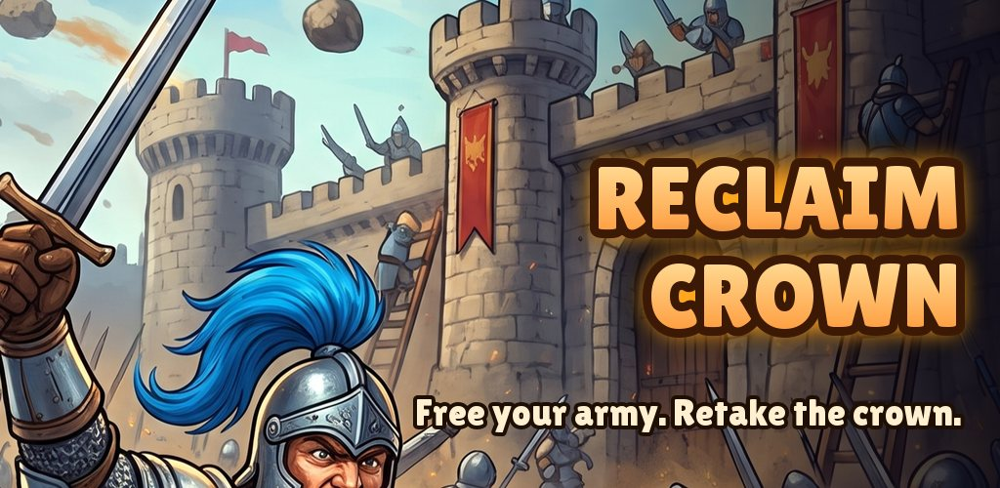
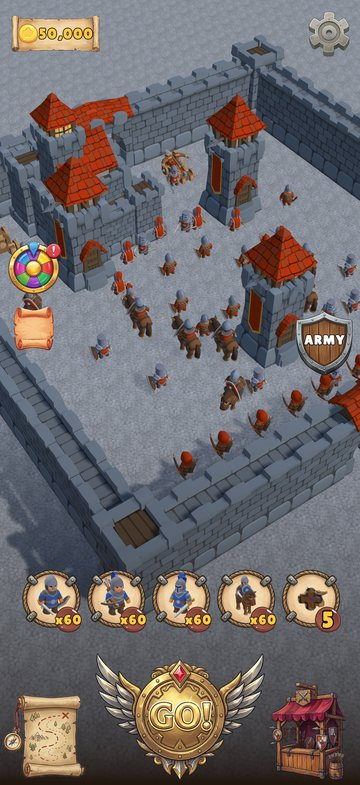
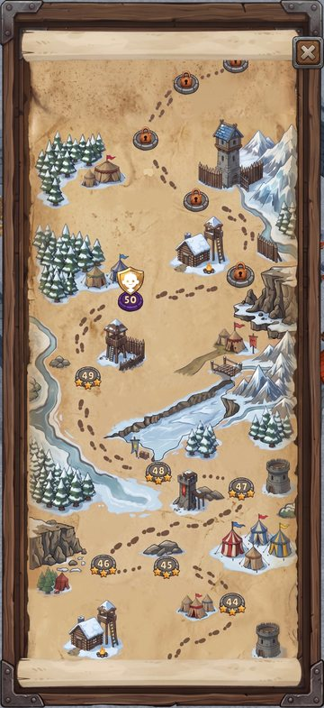
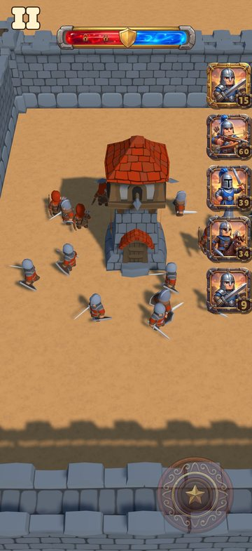
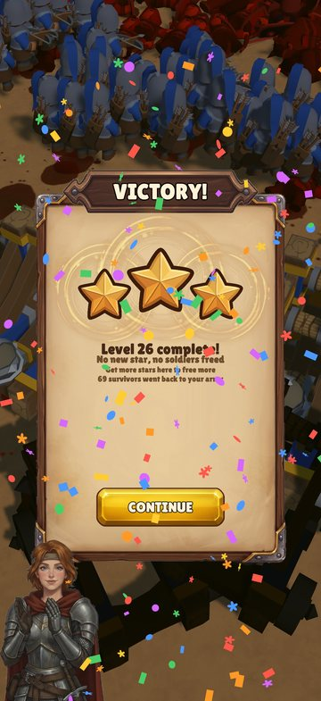
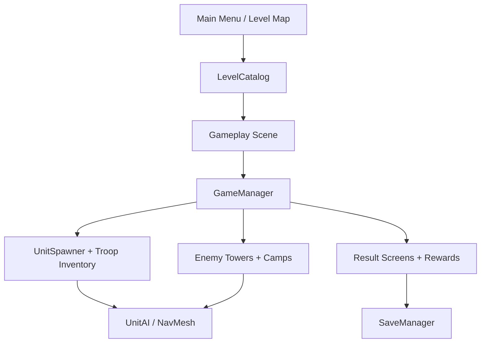

  

  <h1>Reclaim Crown</h1>
  
<b>Hybrid-casual 3D tower war for Android: place your army, then watch the battle</b>

 

## 📌 Overview

**Reclaim Crown** is a 3D tower-war game built in Unity. You choose a squad, drop troops onto the battlefield, and watch them fight through enemy camps, walls, gates and towers. Players free soldiers by winning stars, unlock new troops and siege machines as they progress, and follow a short story about taking the crown back.

It is currently in Google Play closed testing (package `com.kambogames.reclaimcrown`).

---

## 📸 Screenshots

  
  
  
  

---

## ✨ Features

- **50 levels** across several terrain themes, with hard levels every tenth level and per-level enemy strength.
- **Troops and machines:** 9 troop types plus a ballista, catapult and ram (unlocked through levels), squad loadouts and 10-level troop upgrades.
- **NavMesh battle AI:** troops pick targets, engage nearby enemies before walls and towers, and ranged units spread their fire.
- **Destructible fort:** breakable walls, gates and towers; machines are needed to break walls.
- **Progression and rewards:** stars give soldiers, chests, a daily reward calendar and a spin wheel.
- **Story intro and tutorials:** a 3D story scene, a commander character and short per-level tutorials.
- **Polish:** HUD balance bar, camera shake and haptics, sound and music settings, loading tips and crash reporting through Unity Cloud Diagnostics.

---

## 🛠 Tech Stack

- **Engine:** Unity 6 (URP), C#
- **Key systems:** NavMesh agents, a data-driven level catalogue and level builder, save system, runtime-built UI panels
- **Platform:** Android (IL2CPP, ARM64, App Bundle)

---

## 🏗 Architecture

---

## 📈 Challenges Faced

- **Troops getting stuck at walls:** chasing enemies behind closed gates left troops confused. Fixed by checking for a walkable line with `NavMesh.Raycast` before engaging.
- **Phone-only bugs:** terrain used materials that were not included in builds, so the ground was missing on device. Fixed by moving every terrain to a built-in URP material.
- **Large first-frame stalls:** shaders compiled on first draw. Added a shader warm-up collection and a loading screen that waits for smooth frames.

---

## 💡 What I Learned

- Designing a data-driven level pipeline so 50 levels can be rebuilt from one plan.
- Debugging device-only issues from crash reports and logs.
- Balancing economy and difficulty: stars grant soldiers, hard levels spike every ten levels.
