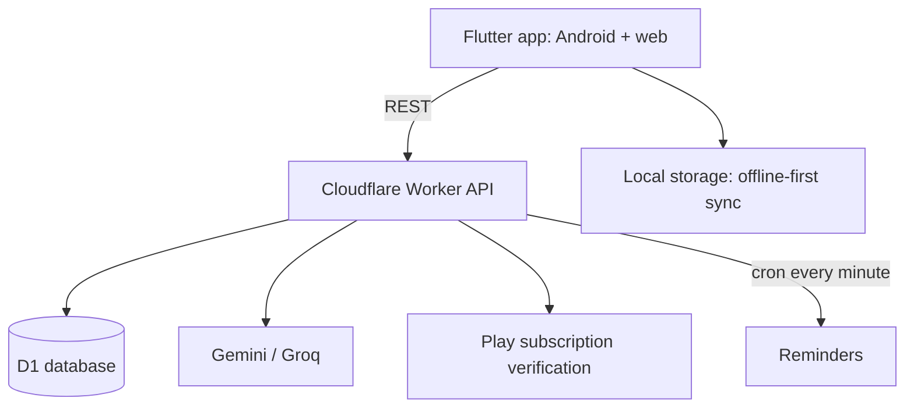

  <h1>StratGo AI</h1>
  
<b>Personal-secretary planner for Android and the web</b>

 

## 📌 Overview

**StratGo** is an offline-first planner that works like a personal secretary: tasks and events with multiple reminders, alarms that ring until stopped, repeating tasks, checklists, tags, a calendar, habits, and an AI assistant that creates tasks from text, voice, photos or PDFs.

- **Web app:** https://stratgo-web.stratgo-bot.workers.dev
- **Android:** package `com.kambostudios.stratgo` (Google Play)

---

## ✨ Features

- **Quick add:** type "call bank tomorrow 5pm" and the task is created.
- **Reminders that work:** several offsets from one week to one minute, ring-until-stopped alarms, snooze and Done buttons in the notification, a reminder-health screen.
- **Planning:** repeating tasks, checklists, tags and filters, search, calendar with a Today button, habits with streaks.
- **AI assistant:** text, voice, and photo/PDF import (fast multi-model import).
- **Extras:** home-screen widget, wallpapers, local-only privacy mode, data export (CSV/JSON).
- **Accounts and billing:** email, guest and Google sign-in; Google Play Billing subscriptions with server-side verification and a signed 72-hour offline lease.

---

## 🛠 Tech Stack

- **App:** Flutter, Dart (Android and web from one codebase)
- **Backend:** Cloudflare Workers with a D1 database (accounts, sync, assistant, plans, billing, cron-driven reminders)
- **AI:** Gemini API and Groq models
- **Payments and auth:** Google Play Billing, Google sign-in, JWT
- **History:** an earlier prototype used Spring Boot, PostgreSQL and Docker (now retired in favour of the serverless backend)

---

## 🏗 Architecture

---

## 📈 Challenges Faced

1. **Sync that never resurrects deleted data:** the first version brought deleted tasks back after going online. Redesigned the offline-first sync so deletions always win.
2. **Reliable alarms on Android:** moved to several reminder offsets, ring-until-stopped alarms and notification actions, plus a health screen that explains missing permissions.
3. **Zero-cost infrastructure:** replaced a free-tier Java host and external database with Cloudflare Workers and D1, cutting running cost to free tiers.

---

## 💡 What I Learned

- Designing offline-first sync and signed offline leases for subscriptions.
- Server-side verification of Play purchases, renewals and refunds.
- Prompting LLMs to return strictly structured JSON for task creation.
