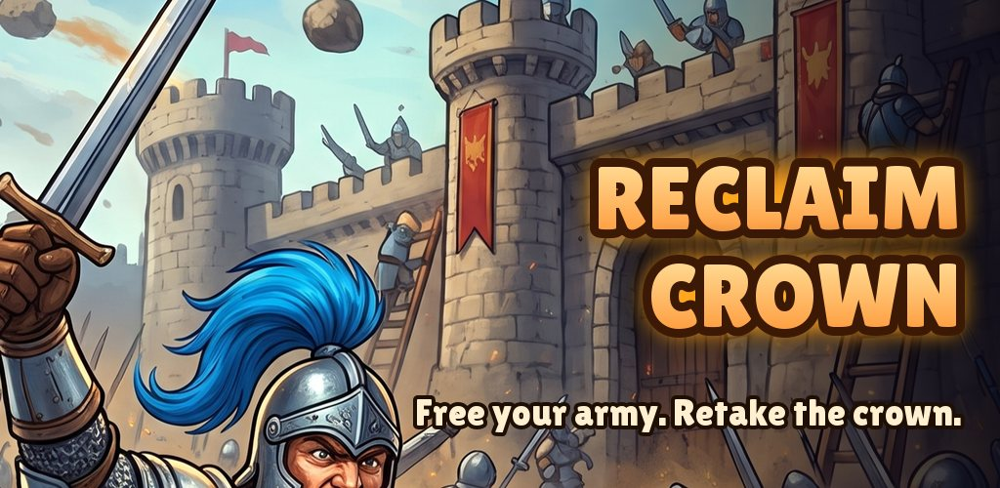
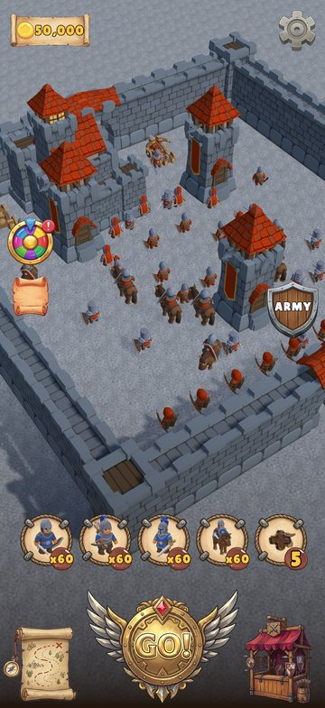
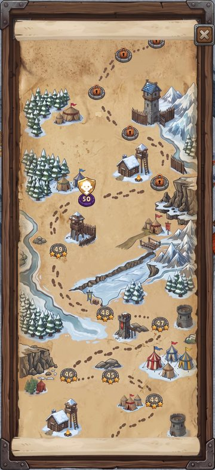
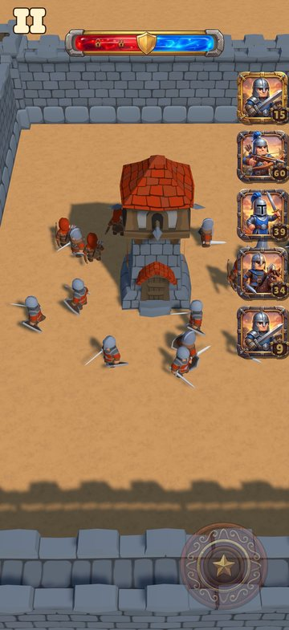
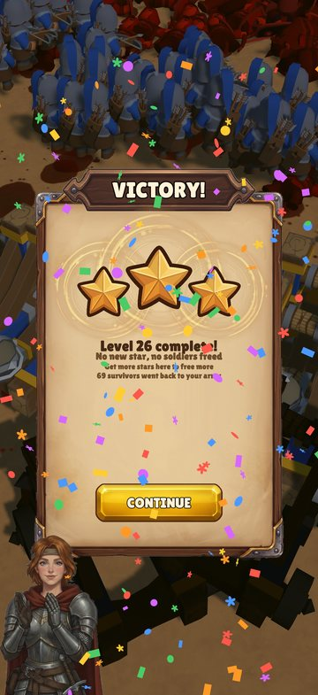

<!-- ══════════════════════════════════════════════════════════ HEADER -->
<h1 align="center">
  
</h1>

<!-- ══════════════════════════════════════════════════════════ TYPING BANNER -->
<p align="center">
  
</p>

<!-- ══════════════════════════════════════════════════════════ BADGES -->
<p align="center">
  
  &nbsp;
  <a href="https://www.linkedin.com/in/sahibnoorsingh17/">
    
  </a>
  &nbsp;
  <a href="mailto:kambojsahibnoor@gmail.com">
    
  </a>
  &nbsp;
  <a href="./Resume.pdf">
    
  </a>
</p>

---

## ◈ Who I Am

```text
🎓  Education       Thapar Institute of Engineering and Technology (B.E. Computer Engineering '28)
💼  Experience      Founder & Developer @ Kambo Game Studio (2025 - Present)
📈  Quant           Research Consultant @ WorldQuant BRAIN (2026 - Present)
💻  Backend         Java, Spring Boot, PostgreSQL, Elasticsearch, Cloudflare Workers + D1
☁️  Cloud/DevOps    AWS (VPC, EC2, S3, IAM), Docker, GitHub Actions CI/CD, Terraform, Linux
📱  Mobile/Desktop  Flutter, Dart, C#/WPF, REST APIs
🎮  Game Dev        Unity 2D/3D, AdMob, Unity IAP, Voodoo CPI testing
🤖  AI/ML           Google Gemini API, ONNX Runtime, Python, CNNs
🧠  Philosophy      Build -> Ship -> Analyze -> Improve
```

> **I build complete experiences—from scalable backends to engaging game mechanics.**
>
> Whether it's architecting a serverless backend, crafting a fluid Flutter UI, deploying a CI/CD pipeline on AWS, or designing an addictive Unity game loop, I focus on delivering polished, production-ready products. I run my own game studio, manage the full production lifecycle, and have taken games through Voodoo's CPI testing pipeline.

---

## 💼 Experience

<table>
<tr>
<td width="100%" valign="top">

### 🕹️ Kambo Game Studio
`Founder & Developer · 2025 – Present`

Independent Android game studio building and publishing games in Unity.
- Manages the complete production lifecycle: development, testing, release management, analytics, and monetization (AdMob, Unity IAP).
- Took three games through **Voodoo's CPI testing**, then reworked onboarding, retention hooks, economy and ads for the 2026 Play Store updates.
- Publisher on the **Unity Asset Store** with two game templates and recurring paid sales.

</td>
</tr>
<tr>
<td width="100%" valign="top">

### 📈 WorldQuant BRAIN
`Research Consultant · 2026 – Present`

- Researches and submits quantitative alpha signals on the BRAIN platform as a paid consultant, with regular base-fee and quarterly performance payouts.

</td>
</tr>
</table>

---

## 🚀 Currently Building

<table>
<tr>
<td width="50%" valign="top">

### 🧠 StratGo AI
`Flutter · Cloudflare Workers · D1 · Gemini API`

An offline-first personal-secretary planner for Android and web.
- AI assistant (text, voice, photo/PDF import), ring-until-stopped alarms, widget, multi-reminders.
- Google Play Billing subscriptions with server-side verification and signed offline leases.
- Serverless backend on Cloudflare Workers + D1 (migrated from a Spring Boot / PostgreSQL / Docker prototype).
- Try the [web app](https://stratgo-web.stratgo-bot.workers.dev) · [Development docs](./Projects%20Documentation/StratGo%20Documentation.md)

</td>
<td width="50%" valign="top">

### 🐾 Pawlet
`C# · WPF · .NET · ONNX Runtime`

A Windows desktop pet that turns a photo of your real pet into an animated cartoon companion.
- On-device ONNX models for background removal and species/breed recognition.
- Low-CPU animation engine (~3% of one core), focus timer, installer and crash reporting.

</td>
</tr>
<tr>
<td colspan="2" valign="top">

### 🏰 Reclaim Crown
`Unity 6 · C# · URP`

A hybrid-casual 3D tower war for Android: place your army, then watch the battle. In Google Play closed testing.
- 50 levels, 9 troop types plus siege machines (ballista, catapult, ram), troop upgrades, destructible walls, gates and towers.
- NavMesh battle AI, story intro, daily rewards, chests and a spin wheel.
- [Development docs](./Projects%20Documentation/Reclaim%20Crown%20Documentation.md)

<p align="center">
  
</p>
<p align="center">
  
  
  
  
</p>

</td>
</tr>
</table>

---

## 🎮 Published Products (Kambo Game Studio)

<table>
<tr>
<td width="50%" valign="top">

### 🫧 Bubbly Bub
`Bubble Shooter`

A physics-based bubble shooter with 52 handcrafted levels.


- **Integrations:** AdMob, Remove Ads purchase, Play Store release.
- **Tech Stack:** Unity, C#.
- [Google Play](https://play.google.com/store/apps/details?id=com.kambogames.bubblybub) · [Documentation](./Projects%20Documentation/Bubbly%20Bub%20Documentation.md)

</td>
<td width="50%" valign="top">

### 🧩 Match'em All
`Tile Matching Game`

A tile-matching puzzle with a solvable-board generator, consent flow and level-map home screen.


- **Integrations:** AdMob, Unity IAP (Remove Ads).
- **Business:** went through Voodoo's CPI test, then reworked for organic Play Store growth.
- [Google Play](https://play.google.com/store/apps/details?id=com.kambogames.matchemall) · [Documentation](./Projects%20Documentation/Match'em%20All%20Documentation.md)

</td>
</tr>
<tr>
<td colspan="2" valign="top">

### 📦 Merge'em All
`Simulation / Merge Game`

A merge-and-deliver game in production with modular inventory systems and order management; build size reduced from 100 MB to 76 MB.
- [Google Play](https://play.google.com/store/apps/details?id=com.kambogames.mergeemall) · [Documentation](./Projects%20Documentation/Merge'em%20All%20Documentation.md)

</td>
</tr>
</table>

---

## ☁️ Cloud & DevOps

<table>
<tr>
<td width="100%" valign="top">

### 🔁 CI/CD Pipeline on AWS
`AWS · Docker · GitHub Actions · Terraform`

- Custom **VPC** with public/private subnets, route tables, internet gateway and a **bastion host**; EC2 and S3 via CLI.
- Multi-stage **Docker** images, Docker Compose with Postgres and volumes, pushed to Docker Hub.
- **GitHub Actions** pipeline: run tests, log in with secrets, build and push the image, then auto-deploy to EC2 over SSH.
- **Terraform** for S3 and VPC provisioning (state, plan/apply/destroy).

</td>
</tr>
</table>

---

## ⚙️ Backend & AI Architecture

<table>
<tr>
<td width="50%" valign="top">

### 📊 AI Project Manager
`Java · Elasticsearch · ES|QL`

An AI-powered project management assistant capable of workload analysis and deadline monitoring.
- Built ES|QL-based analytics pipelines for project insights.
- Designed intelligent reporting workflows to identify project risks.
- [View Architecture & Docs](./Projects%20Documentation/AI%20Project%20Manager%20Documentation.md)

</td>
<td width="50%" valign="top">

### 🔢 Handwritten Digit Recognition
`Machine Learning · Python`

A CNN-based handwritten digit classification model built using Python and Jupyter Notebook.
- [View Architecture & Docs](./Projects%20Documentation/Digit%20Recognition%20Documentation.md)

</td>
</tr>
</table>

---

## 👻 Augmented Reality

<table>
<tr>
<td width="100%" valign="top">

### 📱 Snapchat Lenses
`SnapAR · Lens Studio`

Published 6+ AR lenses using Lens Studio.
- **Metrics:** 790K+ views, 741K+ plays, 4.6K+ shares, and 1K+ posts.
- [View Development Docs](./Projects%20Documentation/Snapchat%20Lenses%20Documentation.md)

</td>
</tr>
</table>

---

## 🏆 Achievements & Education

- **Education:** B.E. in Computer Engineering, Thapar Institute of Engineering and Technology (CGPA: 7.44/10)
- **Awards:** Semi Finalist — Tata Imagination Challenge 2025 | Winner — Unstop Talent Awards 2026

---

## 🛠 Tech Stack

<p align="center">
  
</p>
